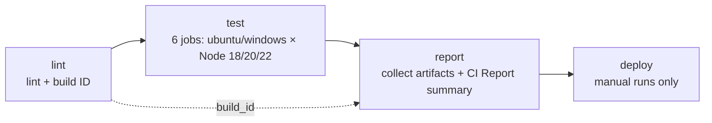

# CI Pipeline Assignment 2: Growing Your CI Pipeline

[](https://github.com/<your-username>/<your-repo>/actions/workflows/ci.yml)
[](https://github.com/<your-username>/<your-repo>/actions/workflows/release.yml)

> Replace `<your-username>/<your-repo>` in the badge links with your GitHub
> repository path.

A GitHub Actions learning project that grows a single-job CI pipeline into a
multi-job pipeline: parallel jobs, a 6-way OS × Node matrix, artifacts and job
outputs passed between jobs, a run summary report, a manual deploy with
inputs and a secret, a custom composite action, concurrency and timeouts,
and a tag-triggered release with least-privilege token permissions.

## Project summary

| | |
| --- | --- |
| **Course work** | Assignment 2: Growing Your CI Pipeline (follows Assignment 1, a basic single-job CI) |
| **Platform** | GitHub Actions on GitHub-hosted runners (Ubuntu and Windows) |
| **Language** | Node.js (placeholder `lint` and `test` scripts; the pipeline is the subject) |
| **Scenario** | The team has grown: test on several Node versions and OSes, split work into jobs, pass results between jobs, keep a deploy secret out of the code, and remove repeated setup |

### What the pipeline does



| Workflow | Trigger | Jobs |
| --- | --- | --- |
| [ci.yml](.github/workflows/ci.yml) (**CI Advanced**) | Push to `main` (except Markdown-only changes), pull requests to `main`, or **Run workflow** button | `lint` → `test` (matrix of 6) → `report` → `deploy` (manual only) |
| [release.yml](.github/workflows/release.yml) (**Release**) | Push of a tag matching `v*` | `release`: creates a GitHub Release with an attached file |

| Feature | Where | GitHub Actions concept |
| --- | --- | --- |
| Separate jobs in order | `lint` → `test` → `report` → `deploy` | `needs:` |
| 6 test combinations in parallel | `test` | `strategy.matrix`, `fail-fast: false` |
| npm dependency cache | Composite action | `actions/setup-node` `cache: 'npm'` |
| Per-combination test output | `test` | `actions/upload-artifact`, unique names |
| Collect all results | `report` | `actions/download-artifact` |
| Build ID passed between jobs | `lint` → `report` | `$GITHUB_OUTPUT`, job `outputs` |
| Readable run report | `report` | `$GITHUB_STEP_SUMMARY` |
| Manual deploy with options | `deploy` | `workflow_dispatch` inputs, `if:` |
| Secret used without printing it | `deploy` | `secrets`, step `env:` |
| Reusable setup | [setup-project](.github/actions/setup-project/action.yml) | Composite action |
| Cancel superseded runs | Top of `ci.yml` | `concurrency`, `cancel-in-progress` |
| Skip docs-only pushes | `on.push` | `paths-ignore` |
| Stop hung jobs | `lint`, `test` | `timeout-minutes` |
| Release with minimal rights | `release.yml` | `permissions: contents: write` |

## Repository structure

```text
.
├── .github/
│   ├── actions/
│   │   └── setup-project/
│   │       └── action.yml          # Composite action: setup-node (with npm cache) + npm ci
│   └── workflows/
│       ├── ci.yml                  # Main pipeline (CI Advanced)
│       └── release.yml             # Tag-triggered release
├── docs/
│   ├── assign_1/                   # Assignment 1 documents
│   └── assignment-2/
│       ├── Assignment-2-Growing-Your-CI-Pipeline.docx   # Original assignment
│       ├── assignment-2-growing-your-ci-pipeline.md     # Assignment in Markdown
│       ├── project-guide.md        # Beginner step-by-step guide + production recommendations
│       ├── answer-sheet.md         # Blank answer sheet (Appendix A)
│       ├── checkpoints/            # The workflow at every step, incl. deliberate failures
│       └── assignment-2-python-edition.md
├── .gitignore
├── package.json                    # lint and test scripts
├── package-lock.json               # Required by npm ci and the npm cache
└── README.md
```

## Tools and prerequisites

| Tool | Version | Purpose |
| --- | --- | --- |
| GitHub account | n/a | Hosts the repository and runs the workflows |
| Git | 2.x | Commit, push, and push tags |
| Node.js + npm | Current LTS | Run the scripts locally and generate `package-lock.json` |
| Code editor | e.g. VS Code | Edit YAML (the "GitHub Actions" and "YAML" extensions help) |
| GitHub CLI `gh` | Optional | Trigger and watch runs from the terminal |

> [!IMPORTANT]
> Use a **public** repository. Public repositories get unlimited free
> GitHub-hosted runner minutes; the matrix includes Windows runners, which
> consume private-repository minutes at twice the Linux rate.

## Getting started

### 1. Run the scripts locally

```bash
npm ci          # install exactly what package-lock.json lists (nothing, here)
npm run lint    # prints: Linting... no problems found!
npm test        # prints: All tests passed successfully!
```

### 2. One-time repository settings on GitHub

| Setting | Where | Value |
| --- | --- | --- |
| Deploy secret | **Settings > Secrets and variables > Actions > New repository secret** | Name `FAKE_API_KEY`, value `hunter2-abcdef` (a fake practice value) |
| Default token permissions | **Settings > Actions > General > Workflow permissions** | **Read repository contents and packages permissions** |
| Default branch | **Settings > General** | `main` |

### 3. Run the pipeline

**Automatically:** push to `main` or open a pull request against `main`.

```bash
git add .
git commit -m "Describe your change"
git push
```

Pushes that change only `*.md` files do not start a run.

**Manually (with deploy):** **Actions > CI Advanced > Run workflow**, choose
`target` (`staging` / `production`) and tick or untick **dry run**. Or with
the GitHub CLI:

```bash
gh workflow run ci.yml -f target=staging -f dry_run=true
gh run watch
```

**Release:** push a tag that starts with `v`.

```bash
git tag v1.0.1
git push origin v1.0.1
```

The release appears under **Releases** on the repository home page with
`release-notes.txt` attached.

### 4. Read the results

- **Actions tab > a run**: job diagram, per-job logs.
- **Summary page of a run**: the **CI Report** panel (build ID, commit,
  actor, branch, collected artifacts).
- **Bottom of the Summary page**: six `test-results-<os>-node<version>`
  artifacts.

## Doing the assignment

> [!WARNING]
> The files in this repository are the **finished** state. The assignment
> grades your **commit history**: it expects commits showing each deliberate
> failure (broken `needs`, artifact name clash, missing `shell`, HTTP 403)
> followed by its fix. Do not push these finished files in one commit. Build
> your repository step by step with the
> [Project Guide](docs/assignment-2/project-guide.md), and use the finished
> files and the [checkpoints](docs/assignment-2/checkpoints/) only to compare.

1. Read the [assignment](docs/assignment-2/assignment-2-growing-your-ci-pipeline.md).
2. Follow the [Project Guide](docs/assignment-2/project-guide.md) step by step.
3. Fill in the [answer sheet](docs/assignment-2/answer-sheet.md).
4. Submit the repository link, the answer sheet and three screenshots (job
   diagram, CI Report panel, release page).

## Production recommendations

This is a teaching pipeline: the lint and test scripts are placeholders and
the deploy only echoes. Section 14 of the
[Project Guide](docs/assignment-2/project-guide.md#14-real-production-what-to-improve)
covers what a real team would change, including: real lint and tests,
supported Node LTS versions only, actions pinned to commit SHAs with
Dependabot, top-level `permissions: contents: read`, GitHub Environments with
required reviewers, OIDC instead of static keys, non-cancelling deploy
concurrency, branch and tag rulesets, artifact retention, and release
provenance.

## Troubleshooting

| Problem | Fix |
| --- | --- |
| No run after a push | Check the file is under `.github/workflows/`, you pushed to `main`, and the push changed more than `.md` files. |
| `npm ci` / cache fails about a lock file | Commit `package-lock.json` (run `npm install` first). |
| No **Run workflow** button | `workflow_dispatch` must be on the default branch; refresh the page. |
| Release fails with HTTP 403 | The job needs `permissions: contents: write`; push a new tag after fixing. |

More in [Project Guide, section 13](docs/assignment-2/project-guide.md#13-troubleshooting).
